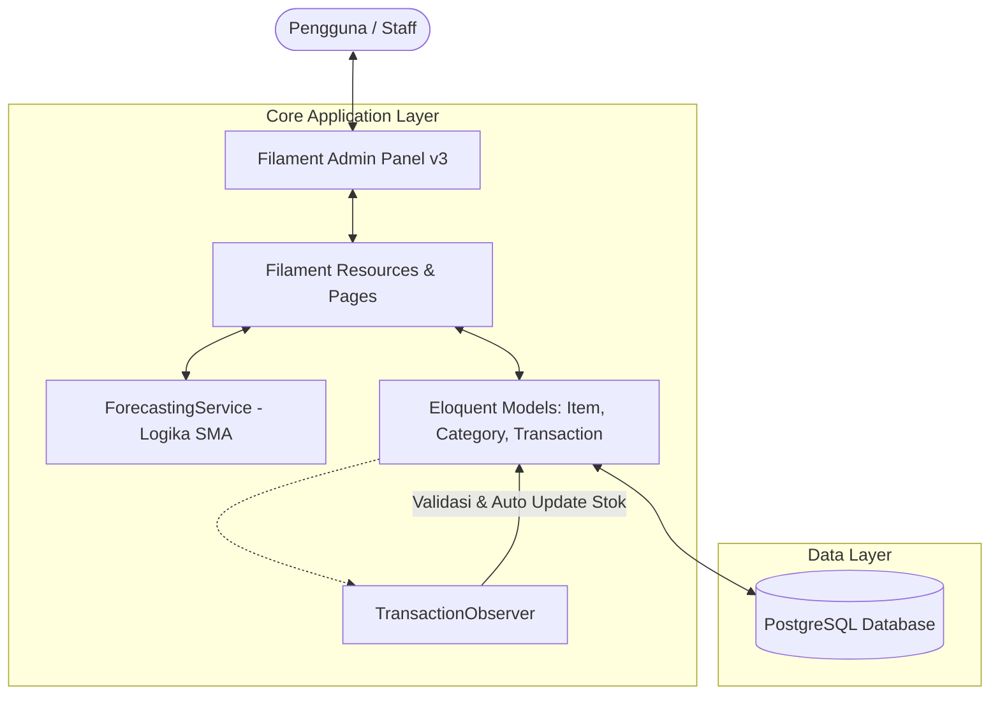
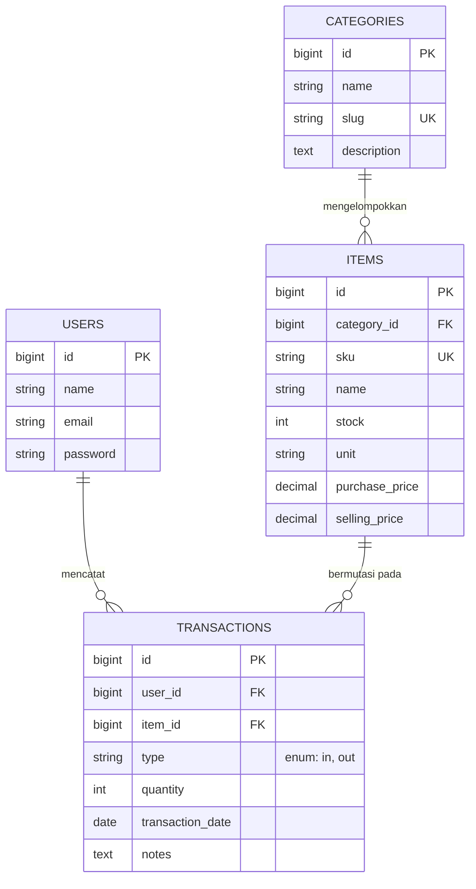

# SInventory 📦
### *Smart Inventory Management & Demand Forecasting Decision Support System*

[](https://laravel.com)
[](https://filamentphp.com)
[](https://www.postgresql.org)
[](https://www.docker.com)
[](https://phpunit.de)

**SInventory** adalah sistem manajemen inventaris gudang enterprise yang dirancang tidak hanya untuk mencatat arus mutasi barang, melainkan juga berfungsi sebagai **Sistem Pendukung Keputusan (*Decision Support System*)** pengadaan barang logistik berbasis peramalan statistik **Simple Moving Average (SMA)**.

---

## 📌 Latar Belakang & Masalah (Problem Statement)

Dalam pengelolaan inventaris dan rantai pasok (*supply chain*), perusahaan dan UMKM kerap menghadapi tantangan klasik:
1. **Risiko Overstocking (Penumpukan Modal):** Pembelian barang logistik yang berlebihan karena estimasi intuitif tanpa data historis, mengakibatkan gudang penuh dan perputaran modal kerja mandek.
2. **Risiko Stockout (Kehabisan Barang):** Terlambat menyadari bahwa persediaan barang operasional penting menipis, sehingga menghambat produktivitas dan operasional kantor.
3. **Ketidaksinkronan Catatan Stok (Human Error):** Mutasi barang masuk dan keluar yang dicatat manual seringkali memicu stok minus atau selisih data antara fisik gudang dan pembukuan.

---

## 💡 Solusi yang Dihadirkan (The Solution)

**SInventory** menyelesaikan permasalahan tersebut melalui pendekatan arsitektur modern dan analitik data:
- **Otomatisasi Mutasi & Pencegahan Stok Minus:** Menggunakan **Laravel Observer Pattern** untuk memutasi stok secara atomik dan *real-time*. Sistem secara otomatis membatalkan transaksi keluar (*Outbound*) jika stok fisik tidak mencukupi serta mendukung *auto-rollback* stok saat transaksi dihapus.
- **Prediksi Kebutuhan Pengadaan (Simple Moving Average Engine):** Menganalisis histori pemakaian hingga 5 tahun ke belakang untuk memprediksi estimasi kebutuhan bulan berikutnya dan menghitung kuantitas rekomendasi restock otomatis.
- **Fleksibilitas Parameter Jendela (Customizable SMA Window):** Memungkinkan manajer logistik menyesuaikan jendela pengamatan (2 bulan, 3 bulan standar, 6 bulan, hingga 12 bulan) dengan penjelasan edukatif mengenai sensitivitas data.
- **Visibilitas Valuasi Finansial Aset:** Dashboard real-time yang menghitung total nilai aset gudang ($\sum \text{stok} \times \text{harga beli}$) serta memberikan peringatan dini (*early warning indicator*) untuk barang yang menipis ($\le 5$ unit).

---

## ✨ Fitur-Fitur Utama

### 1. 📊 Executive Dashboard & Real-Time Analytics
- **Kartu Metrik Finansial:** Total barang, total kategori, valuasi total aset dalam Rupiah, dan rekap mutasi bulanan.
- **Indikator Stok Kritis (Warning Badge):** Mendeteksi barang dengan stok menipis secara otomatis.
- **Interactive Mutasi Trend Chart:** Grafik garis interaktif 12 bulan terakhir yang membandingkan tren Inbound vs Outbound.
- **Demand Forecasting Chart:** Grafik kombinasi Bar (aktual) dan Dashed Line (SMA) dengan filter interaktif per barang, jendela perhitungan (2-12 bulan), dan rentang waktu (1-5 tahun).

### 2. 📦 Master Data & Relasi Terintegrasi
- **Manajemen Kategori:** Auto-slug generator dan *badge* counter total barang per kategori.
- **Manajemen Barang (Items):** SKU unik, satuan kustom, harga beli, harga jual, dan status warna stok otomatis (*Merah: Habis, Kuning: Menipis $\le 5$, Hijau: Aman*).
- **Fast Input (Create on the fly):** Tambah kategori baru langsung dari modal form barang.

### 3. 🔄 Modul Transaksi (Inbound & Outbound)
- Pencatatan transaksi barang masuk (*restock supplier*) dan barang keluar (*distribusi operasional*).
- Pencatatan otomatis staf/admin yang bertanggung jawab atas transaksi.
- Filter rentang tanggal (*Date Range Picker*) dan filter tipe transaksi.

### 4. 🛡️ Role & Hak Akses (RBAC)
- Didukung oleh `spatie/laravel-permission` dengan pemisahan peran (`admin` dan `staff`).
- Perlindungan panel menggunakan kontrak `FilamentUser`.

---

## 🏗️ Arsitektur & Pola Desain (System Architecture)



### Pola Desain Unggulan:
- **Service Layer Pattern:** Seluruh perhitungan matematika statistik diisolasi di `App\Services\ForecastingService` sehingga *controller/widget* tetap bersih (*Separation of Concerns*).
- **Observer Pattern:** Pengurangan, penambahan, dan *rollback* stok dipusatkan di `App\Observers\TransactionObserver`, menjamin konsistensi data dari mana pun transaksi dibuat (UI, API, atau Seeder).
- **Defensive Database Handling:** Mekanisme `lockForUpdate()` dan pengecekan stok mencegah kondisi *race condition* dan *negative stock*.

---

## 🗄️ Relasi Database (ERD)



---

## 🛠️ Tech Stack

- **Backend Framework:** [Laravel 11.x](https://laravel.com)
- **Admin Panel & State:** [Filament PHP v3](https://filamentphp.com) (TALL Stack: Tailwind CSS, Alpine.js, Laravel, Livewire)
- **Database:** [PostgreSQL 16](https://www.postgresql.org)
- **Containerization:** [Docker & Laravel Sail](https://laravel.com/docs/11.x/sail)
- **Testing Engine:** [PHPUnit](https://phpunit.de) (Feature & Unit Tests 100% Passed)

---

## 🚀 Panduan Menjalankan Proyek (Local Development)

### 1. Klon Repositori
```bash
git clone git@github.com:elmyandrean/sinventory.git
cd sinventory
```

### 2. Salin Konfigurasi Environment
```bash
cp .env.example .env
```
Sesuaikan konfigurasi koneksi database di `.env` (secara default diarahkan ke PostgreSQL).

### 3. Install Dependensi & Generate App Key
```bash
composer install
php artisan key:generate
```

### 4. Jalankan Container Docker (Laravel Sail)
```bash
./vendor/bin/sail up -d
```

### 5. Eksekusi Migrasi & Simulasi Transaksi (5 Tahun)
```bash
# Jalankan migrasi dan seeder akun admin awal
./vendor/bin/sail artisan migrate --seed

# (Opsional) Jalankan simulasi transaksi 5 tahun untuk analitik peramalan
./vendor/bin/sail artisan db:seed --class=TransactionSimulationSeeder
```

### 6. Akses Panel Admin
Buka browser dan arahkan ke: **[http://localhost/admin](http://localhost/admin)**

**Kredensial Login Default:**
- **Email:** `admin@sinventory.test`
- **Password:** `password`

---

## 🧪 Pengujian Otomatis (Automated Testing)

Proyek ini telah dilengkapi automated test untuk menguji keabsahan alur transaksi dan algoritma peramalan:

```bash
./vendor/bin/sail artisan test
```

**Skenario Uji yang Dicakup:**
- `TransactionObserverTest`: Uji penambahan stok (*Inbound*), pengurangan stok (*Outbound*), penolakan transaksi jika stok tidak cukup, dan *rollback* stok saat transaksi dihapus.
- `ForecastingServiceTest`: Uji akurasi rumus *Simple Moving Average (SMA)* pada data historis.

---

## 👨‍💻 Author

Dikembangkan oleh **Elmy Andrean**  
Sebagai proyek portofolio demonstrasi implementasi sistem inventaris cerdas berbasis data science dan arsitektur web modern.
