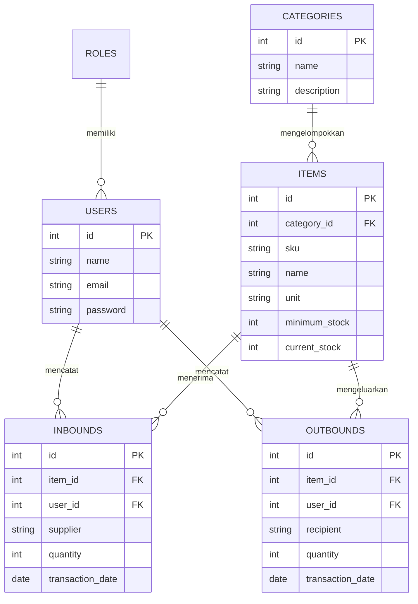

# SInventory (Sistem Inventory dengan Forecasting)

Aplikasi manajemen inventaris gudang komprehensif yang dibangun menggunakan **Laravel 11** dan **Filament PHP**. Aplikasi ini tidak hanya berfungsi untuk mencatat keluar-masuknya barang, tetapi juga dilengkapi dengan fitur analitik cerdas berbasis *Simple Moving Average* untuk mengestimasi (forecasting) kebutuhan pengadaan barang di masa depan.

---

## ✨ Fitur Utama

1. **Manajemen Role & User (Spatie Permission)**
   - Pembatasan hak akses berbasis peran.
   - **Manager/Admin**: Akses penuh ke seluruh sistem, termasuk pengaturan *user*, master data, dan laporan *forecasting*.
   - **Staff Gudang**: Akses operasional harian untuk kelola barang, serta mencatat transaksi masuk/keluar.

2. **Master Data Inventory**
   - Pengelolaan kategori dan barang (SKU, Nama, Satuan, Stok Minimal).
   - Pemantauan metrik stok otomatis (*current stock*).

3. **Transaksi & Kartu Stok (Inbound / Outbound)**
   - **Barang Masuk (Inbound)**: Pencatatan pasokan dari supplier.
   - **Barang Keluar (Outbound)**: Pencatatan pengeluaran barang dari gudang.
   - **Real-time Update**: Terintegrasi dengan *Laravel Observers* untuk memperbarui stok barang secara otomatis di setiap transaksi.

4. **Forecasting (Estimasi Pengadaan)**
   - Prediksi kebutuhan belanja barang di masa depan.
   - Menggunakan metode statistik *Simple Moving Average* berdasarkan riwayat pergerakan *Outbound* dari bulan-bulan sebelumnya.
   - Alert otomatis jika stok suatu barang mendekati atau berada di bawah batas minimum (*Reorder Point*).

5. **Dashboard & Laporan Eksekutif**
   - *Widgets* visual yang menampilkan metrik utama (Barang Terlaris, Stok Kritis, Total Transaksi).

---

## 🛠 Teknologi (Tech Stack)

Proyek ini dibangun di atas infrastruktur web modern (TALL Stack) untuk memastikan UI/UX yang premium dan performa tinggi:

- **Framework**: Laravel 11 (PHP 8.2+)
- **Admin Panel & UI**: Filament PHP v3
- **Frontend Stack**: Tailwind CSS, Alpine.js, Livewire
- **Database**: PostgreSQL
- **Infrastruktur**: Docker (via Laravel Sail)

---

## 🗄️ Rancangan Database (ERD)

Berikut adalah struktur entitas utama di dalam database sistem:



---

## 🚀 Panduan Instalasi (Lokal / Development)

Karena proyek ini dibangun menggunakan Docker (Laravel Sail) dan terhubung dengan PostgreSQL eksternal, ikuti langkah berikut:

1. **Clone Repositori**
   ```bash
   git clone git@github.com:elmyandrean/sinventory.git
   cd sinventory
   ```

2. **Konfigurasi Lingkungan (.env)**
   Salin `.env.example` ke `.env` dan konfigurasikan bagian koneksi Database agar mengarah ke PostgreSQL Anda:
   ```env
   DB_CONNECTION=pgsql
   DB_HOST=172.19.0.2   # Sesuaikan dengan IP Container PostgreSQL Anda
   DB_PORT=5432
   DB_DATABASE=sinventory
   DB_USERNAME=postgres
   DB_PASSWORD=admin
   ```

3. **Instalasi Dependensi**
   Jika Composer sudah terinstal di OS Anda:
   ```bash
   composer install
   ```

4. **Generate App Key**
   ```bash
   php artisan key:generate
   ```

5. **Menjalankan Aplikasi (Docker/Sail)**
   ```bash
   ./vendor/bin/sail up -d
   ```

6. **Migrasi Database & Seeder**
   ```bash
   ./vendor/bin/sail artisan migrate --seed
   ```

Aplikasi kini dapat diakses di browser pada alamat `http://localhost`.
